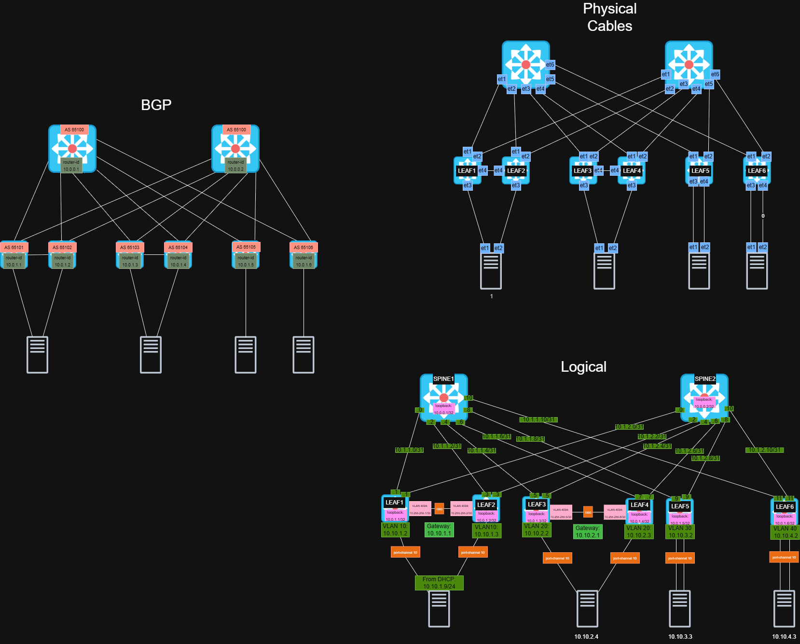

# cEOS_2tier_spine_leaf

## Design
- 2 spines (shared AS 65100) and 6 leaves (one AS each, 65101 to 65106)
- eBGP underlay with ECMP across both spines
- Leaf pairs (leaf1 and leaf2, leaf3 and leaf4) form MLAG pairs, so each
  server bonds one link to each leaf
- Leaf5 and leaf6 each serve one server over a two link LACP bundle
- Anycast gateway on each MLAG pair, using a shared virtual IP and MAC
- DHCP served from the leaf VLAN interfaces, with the range split between
  the two leaves in a pair
- Addressing plan by role: loopbacks 10.0.x.x, spine links 10.1.x.x,
  server subnets 10.10.x.x, MLAG peer links 10.255.255.x

  
